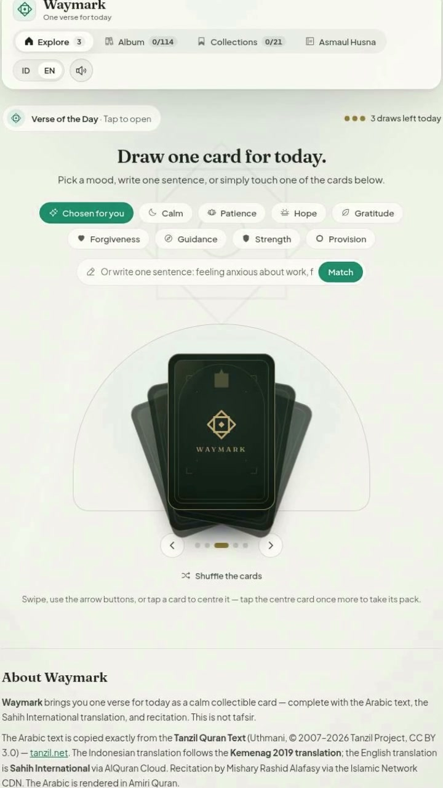

# Waymark

**One verse, one message, for your day.**

Waymark is a daily Quran-verse card app. Open a pack, read a verse, sit with it for a minute. 114 cards — one for every surah — in Indonesian and English, with recitation audio, themed 7-day collections, search, and story sharing.

Just open `index.html`. No build step, no backend, no account. Your progress lives in your browser's localStorage.

https://github.com/user-attachments/assets/c3efabe6-5db0-417b-8516-d64461ee6050

## Features

- **114 verse cards** — one per surah, Arabic (Uthmani script) + translation + a short reflection prompt
- **Pack opening** — a gentle fan of cards, pick one, read it in full
- **8 themes** — Calm, Patience, Hope, Gratitude, Forgiveness, Guidance, Strength, Provision
- **7-day collections** — guided journeys: *7 Days of Calm*, *When Times Are Hard*, *Morning Gratitude* (progress saved locally)
- **Search** — by surah name, surah number, `surah:ayah`, theme, or keyword
- **Bilingual** — Indonesian / English toggle (ID is the default)
- **Murottal** — recitation by Mishary Rashid Alafasy, with fallbacks
- **Share** — export a 1080×1920 story card, or share it directly to WhatsApp / Instagram
- **Asmaul Husna** — all 99 names with meanings, in both languages
- **Journal** — a short note per card, stored locally

## Design — "Kertas Lapis"

Calm, editorial, paper-like. Stone paper `#F5F4EE`, green-charcoal ink `#1C2320`, one deep-teal accent `#0F766E`, brass used only as ornament. Amiri Quran for the Arabic (400 only, never fake-bolded), Fraunces for display, Plus Jakarta Sans for UI. Rub el Hizb 8-point star as the mark. Phosphor icons, one stroke weight, one grid.

Depth comes from separating three planes — the paper ground (layered tones + grain + one soft glow), the focal card (hairline + warm shadow), and a single accent spent once per screen — not from decoration.

The card interactions (fan spread, pack opening, tilt + shine) were reverse-engineered from reference implementations with [REA](https://github.com/morluto/rea) and rebuilt in plain DOM/CSS: single bottom-center pivot, 10° spread per card, spring-driven tilt, one teal-to-brass shine.

## Tech

Single self-contained `index.html` (~700 KB). Vanilla HTML/CSS/JS, no framework, no build. Google Fonts (Amiri Quran, Fraunces, Plus Jakarta Sans) and audio CDNs (Islamic Network, EveryAyah) load at runtime with fallbacks.

## Content & attribution

The reflections are original, short prompts for personal reflection. They are **not tafsir**.

- **Arabic text** — Tanzil Uthmani text, [tanzil.net](https://tanzil.net), CC BY 3.0
- **Indonesian translation** — Kemenag 2019 (Quran Kemenag)
- **English translation** — Sahih International, via the [AlQuran Cloud API](https://alquran.cloud/api) (edition `en.sahih`)
- **Recitation** — Mishary Rashid Alafasy, via the Islamic Network CDN

## License

Code is MIT — see [LICENSE](LICENSE). Verse content belongs to its sources above; the Sahih International translation is used with attribution as shown in the app.

